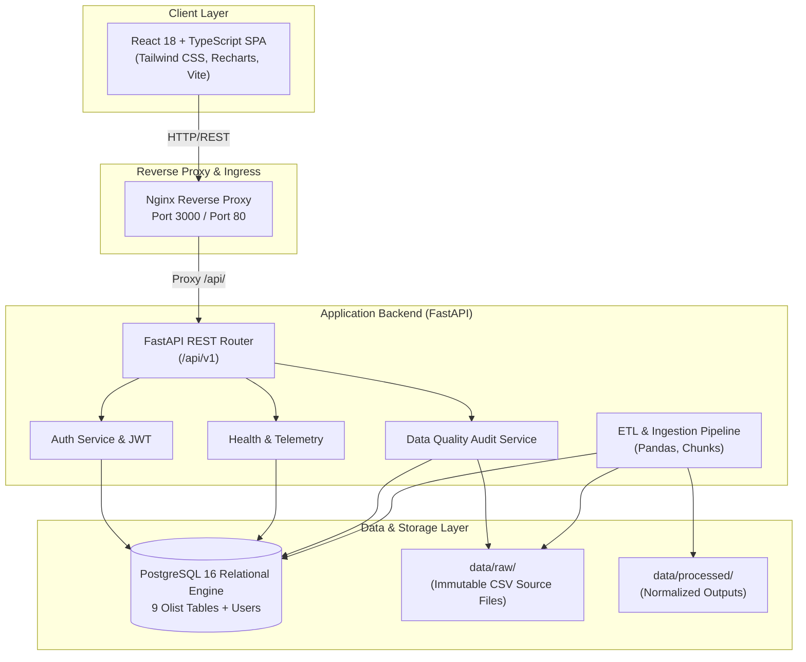

# Platform Architecture & System Design

## 1. High-Level Architecture Overview

## 2. Core Architectural Principles
1. **Raw Data Immutability**: All source CSVs downloaded from Olist are treated as read-only, write-once immutable artifacts.
2. **Strict Separation of Concerns**: React components never perform business calculations or database queries; they communicate via typed REST interfaces.
3. **No Fabricated / Simulated Metrics**: Dashboards reflect true schema metadata, verified table row counts, and null rates calculated directly from SQL queries.
4. **Relational Integrity**: Foreign keys, composite primary keys, and cascade deletion rules safeguard dataset consistency.
5. **Horizontal & Modular Scalability**: Analytical algorithms (RFM, Churn, Forecasting) plug directly into modular service directories in upcoming pipeline stages.
